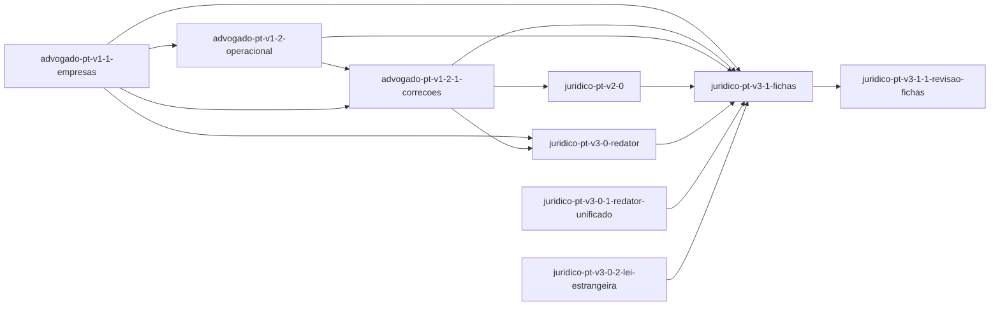

# Roadmap — juridico-pt

<!-- AUTO-GERADO por dev-spec — não editar à mão. -->

**Progresso: 93%** ▰▰▰▰▰▰▰▰▰▱ · 9/10 features completas · 188/191 tasks feitas

_Velocidade: 24.8 ponto(s)/dia útil — 188 tarefa(s), 496 ponto(s) concluídos desde 2026-10-03 (últimos 28 dias)_

Legenda: ✅ feito · 🟡 em curso · ⛔ bloqueada · 📋 planeada · ⬜ por começar

## ▶ A seguir
- **juridico-pt-v3-1-2-revisao-fichas** (core) — próxima #1 Artigos revogados e citações sem «º»:

## Features

| | Feature | Tracks | Fase | % | Tasks | Deps | Próxima | Previsão |
|---|---|---|---|---|---|---|---|---|
| ✅ | [advogado-pt-v1-1-empresas](./advogado-pt-v1-1-empresas/requirements.md) | core +tdd | concluída | 100% | 28/28 | — | — | — |
| ✅ | [advogado-pt-v1-2-1-correcoes](./advogado-pt-v1-2-1-correcoes/requirements.md) | core +tdd +sec | concluída | 100% | 41/41 | advogado-pt-v1-2-operacional ✓, advogado-pt-v1-1-empresas ✓ | — | — |
| ✅ | [advogado-pt-v1-2-operacional](./advogado-pt-v1-2-operacional/requirements.md) | core +tdd | concluída | 100% | 30/30 | advogado-pt-v1-1-empresas ✓ | — | — |
| ✅ | [juridico-pt-v2-0](./juridico-pt-v2-0/requirements.md) | core +tdd +ai +privacy | concluída | 100% | 38/38 | advogado-pt-v1-2-1-correcoes ✓ | — | — |
| ✅ | [juridico-pt-v3-0-1-redator-unificado](./juridico-pt-v3-0-1-redator-unificado/change.md) | core | concluída | 100% | 3/3 | — | — | — |
| ✅ | [juridico-pt-v3-0-2-lei-estrangeira](./juridico-pt-v3-0-2-lei-estrangeira/change.md) | core | concluída | 100% | 3/3 | — | — | — |
| ✅ | [juridico-pt-v3-0-redator](./juridico-pt-v3-0-redator/requirements.md) | core +tdd +ai +privacy | concluída | 100% | 27/27 | advogado-pt-v1-1-empresas ✓, advogado-pt-v1-2-1-correcoes ✓ | — | — |
| ✅ | [juridico-pt-v3-1-1-revisao-fichas](./juridico-pt-v3-1-1-revisao-fichas/change.md) | core | concluída | 100% | 3/3 | juridico-pt-v3-1-fichas ✓ | — | — |
| 📋 | [juridico-pt-v3-1-2-revisao-fichas](./juridico-pt-v3-1-2-revisao-fichas/change.md) | core | tarefas prontas | 30% | 0/3 | — | #1 Artigos revogados e citações sem «º»: | 2026-10-30 |
| ✅ | [juridico-pt-v3-1-fichas](./juridico-pt-v3-1-fichas/requirements.md) | core +tdd +ai | concluída | 100% | 15/15 | advogado-pt-v1-1-empresas ✓, advogado-pt-v1-2-1-correcoes ✓, advogado-pt-v1-2-operacional ✓, juridico-pt-v2-0 ✓, juridico-pt-v3-0-redator ✓, juridico-pt-v3-0-1-redator-unificado ✓, juridico-pt-v3-0-2-lei-estrangeira ✓ | — | — |

Previsão = pontos por fazer ÷ velocidade, em dias úteis (±25%) · `_Size: XS|S|M|L|XL_` numa tarefa = 1/2/3/5/8 pontos; uma tarefa sem tamanho conta como a mediana da sua feature (senão M) · uma feature à espera de uma dependência começa depois da previsão dessa.

## Dependências

## ⚠ Precisa de atenção

- **juridico-pt-v3-1-2-revisao-fichas** — planeia ficheiros da baseline de fecho de advogado-pt-v1-1-empresas: .claude-plugin/marketplace.json, .claude-plugin/plugin.json, CHANGELOG.md, mcp-server/package.json, mcp-server/src/index.ts, +1 outro(s) — declara _Supersedes: advogado-pt-v1-1-empresas/US-n.AC-m_ onde substitui esse comportamento, ou o spec_drift assinala advogado-pt-v1-1-empresas depois do merge
- **juridico-pt-v3-1-2-revisao-fichas** — planeia ficheiros da baseline de fecho de advogado-pt-v1-2-1-correcoes: mcp-server/src/index.ts — declara _Supersedes: advogado-pt-v1-2-1-correcoes/US-n.AC-m_ onde substitui esse comportamento, ou o spec_drift assinala advogado-pt-v1-2-1-correcoes depois do merge
- **juridico-pt-v3-1-2-revisao-fichas** — planeia ficheiros da baseline de fecho de juridico-pt-v2-0: agents/verificador-citacoes.md — declara _Supersedes: juridico-pt-v2-0/US-n.AC-m_ onde substitui esse comportamento, ou o spec_drift assinala juridico-pt-v2-0 depois do merge
- **juridico-pt-v3-1-2-revisao-fichas** — planeia ficheiros da baseline de fecho de juridico-pt-v3-0-1-redator-unificado: .claude-plugin/marketplace.json, .claude-plugin/plugin.json, CHANGELOG.md, CLAUDE.md, mcp-server/package.json, +2 outro(s) — declara _Supersedes: juridico-pt-v3-0-1-redator-unificado/US-n.AC-m_ onde substitui esse comportamento, ou o spec_drift assinala juridico-pt-v3-0-1-redator-unificado depois do merge
- **juridico-pt-v3-1-2-revisao-fichas** — planeia ficheiros da baseline de fecho de juridico-pt-v3-0-2-lei-estrangeira: .claude-plugin/marketplace.json, .claude-plugin/plugin.json, CHANGELOG.md, mcp-server/package.json, mcp-server/src/index.ts, +1 outro(s) — declara _Supersedes: juridico-pt-v3-0-2-lei-estrangeira/US-n.AC-m_ onde substitui esse comportamento, ou o spec_drift assinala juridico-pt-v3-0-2-lei-estrangeira depois do merge
- **juridico-pt-v3-1-2-revisao-fichas** — planeia ficheiros da baseline de fecho de juridico-pt-v3-0-redator: .claude-plugin/marketplace.json, .claude-plugin/plugin.json, CHANGELOG.md, CLAUDE.md, agents/verificador-citacoes.md, +11 outro(s) — declara _Supersedes: juridico-pt-v3-0-redator/US-n.AC-m_ onde substitui esse comportamento, ou o spec_drift assinala juridico-pt-v3-0-redator depois do merge
- **juridico-pt-v3-1-2-revisao-fichas** — planeia ficheiros da baseline de fecho de juridico-pt-v3-1-1-revisao-fichas: .claude-plugin/marketplace.json, .claude-plugin/plugin.json, CHANGELOG.md, CLAUDE.md, mcp-server/package.json, +7 outro(s) — declara _Supersedes: juridico-pt-v3-1-1-revisao-fichas/US-n.AC-m_ onde substitui esse comportamento, ou o spec_drift assinala juridico-pt-v3-1-1-revisao-fichas depois do merge
- **juridico-pt-v3-1-2-revisao-fichas** — planeia ficheiros da baseline de fecho de juridico-pt-v3-1-fichas: mcp-server/scripts/ao90.json, mcp-server/scripts/gerar-epigrafes.mjs, mcp-server/scripts/importar-fichas.mjs, skills/juridico-pt/assets/fichas/revisao-citacoes.json, skills/juridico-pt/references/epigrafes/CC.json — declara _Supersedes: juridico-pt-v3-1-fichas/US-n.AC-m_ onde substitui esse comportamento, ou o spec_drift assinala juridico-pt-v3-1-fichas depois do merge

## Backlog (planeadas, ainda sem spec)

_(vazio)_
