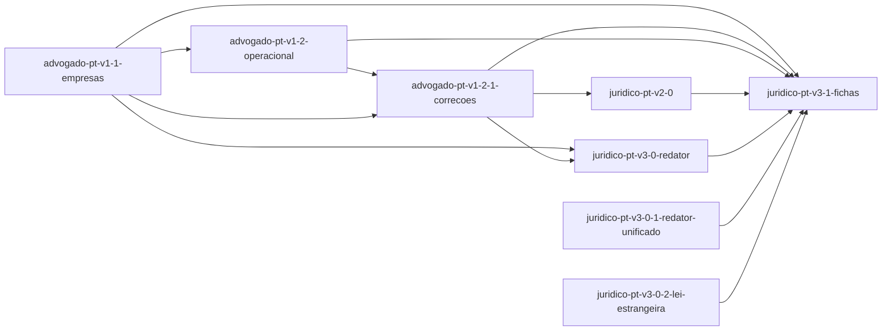

# Roadmap — juridico-pt

<!-- AUTO-GERADO por dev-spec — não editar à mão. -->

**Progresso: 91%** ▰▰▰▰▰▰▰▰▰▱ · 7/8 features completas · 170/185 tasks feitas

_Velocidade: 26 ponto(s)/dia útil — 170 tarefa(s), 442 ponto(s) concluídos desde 2026-10-03 (últimos 28 dias)_

Legenda: ✅ feito · 🟡 em curso · ⛔ bloqueada · 📋 planeada · ⬜ por começar

## ▶ A seguir
- **juridico-pt-v3-1-fichas** (core +tdd +ai) — próxima #1 Base dos 10 casos novos (g51–g58, a14, r06

## Features

| | Feature | Tracks | Fase | % | Tasks | Deps | Próxima | Previsão |
|---|---|---|---|---|---|---|---|---|
| ✅ | [advogado-pt-v1-1-empresas](./advogado-pt-v1-1-empresas/requirements.md) | core +tdd | concluída | 100% | 28/28 | — | — | — |
| ✅ | [advogado-pt-v1-2-1-correcoes](./advogado-pt-v1-2-1-correcoes/requirements.md) | core +tdd +sec | concluída | 100% | 41/41 | advogado-pt-v1-2-operacional ✓, advogado-pt-v1-1-empresas ✓ | — | — |
| ✅ | [advogado-pt-v1-2-operacional](./advogado-pt-v1-2-operacional/requirements.md) | core +tdd | concluída | 100% | 30/30 | advogado-pt-v1-1-empresas ✓ | — | — |
| ✅ | [juridico-pt-v2-0](./juridico-pt-v2-0/requirements.md) | core +tdd +ai +privacy | concluída | 100% | 38/38 | advogado-pt-v1-2-1-correcoes ✓ | — | — |
| ✅ | [juridico-pt-v3-0-1-redator-unificado](./juridico-pt-v3-0-1-redator-unificado/change.md) | core | concluída | 100% | 3/3 | — | — | — |
| ✅ | [juridico-pt-v3-0-2-lei-estrangeira](./juridico-pt-v3-0-2-lei-estrangeira/change.md) | core | concluída | 100% | 3/3 | — | — | — |
| ✅ | [juridico-pt-v3-0-redator](./juridico-pt-v3-0-redator/requirements.md) | core +tdd +ai +privacy | concluída | 100% | 27/27 | advogado-pt-v1-1-empresas ✓, advogado-pt-v1-2-1-correcoes ✓ | — | — |
| 📋 | [juridico-pt-v3-1-fichas](./juridico-pt-v3-1-fichas/requirements.md) | core +tdd +ai | tarefas prontas | 30% | 0/15 | advogado-pt-v1-1-empresas ✓, advogado-pt-v1-2-1-correcoes ✓, advogado-pt-v1-2-operacional ✓, juridico-pt-v2-0 ✓, juridico-pt-v3-0-redator ✓, juridico-pt-v3-0-1-redator-unificado ✓, juridico-pt-v3-0-2-lei-estrangeira ✓ | #1 Base dos 10 casos novos (g51–g58, a14, r06 | 2026-10-28 (10-28…10-29) |

Previsão = pontos por fazer ÷ velocidade, em dias úteis (±25%) · `_Size: XS|S|M|L|XL_` numa tarefa = 1/2/3/5/8 pontos; uma tarefa sem tamanho conta como a mediana da sua feature (senão M) · uma feature à espera de uma dependência começa depois da previsão dessa.

## Dependências

## ⚠ Precisa de atenção

_Nada a assinalar ✓_

## Backlog (planeadas, ainda sem spec)

_(vazio)_
