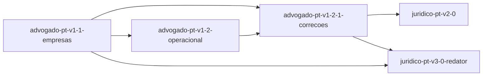

# Roadmap — juridico-pt

<!-- AUTO-GERADO por dev-spec — não editar à mão. -->

**Progresso: 93%** ▰▰▰▰▰▰▰▰▰▱ · 6/7 features completas · 168/170 tasks feitas

_Velocidade: 25.65 ponto(s)/dia útil — 168 tarefa(s), 436 ponto(s) concluídos desde 2026-10-03 (últimos 28 dias)_

Legenda: ✅ feito · 🟡 em curso · ⛔ bloqueada · 📋 planeada · ⬜ por começar

## ▶ A seguir
- **juridico-pt-v3-0-2-lei-estrangeira** (core) — próxima #2 Avaliação a04 com o grader `03-salvaguarda

## Features

| | Feature | Tracks | Fase | % | Tasks | Deps | Próxima | Previsão |
|---|---|---|---|---|---|---|---|---|
| ✅ | [advogado-pt-v1-1-empresas](./advogado-pt-v1-1-empresas/requirements.md) | core +tdd | concluída | 100% | 28/28 | — | — | — |
| ✅ | [advogado-pt-v1-2-1-correcoes](./advogado-pt-v1-2-1-correcoes/requirements.md) | core +tdd +sec | concluída | 100% | 41/41 | advogado-pt-v1-2-operacional ✓, advogado-pt-v1-1-empresas ✓ | — | — |
| ✅ | [advogado-pt-v1-2-operacional](./advogado-pt-v1-2-operacional/requirements.md) | core +tdd | concluída | 100% | 30/30 | advogado-pt-v1-1-empresas ✓ | — | — |
| ✅ | [juridico-pt-v2-0](./juridico-pt-v2-0/requirements.md) | core +tdd +ai +privacy | concluída | 100% | 38/38 | advogado-pt-v1-2-1-correcoes ✓ | — | — |
| ✅ | [juridico-pt-v3-0-1-redator-unificado](./juridico-pt-v3-0-1-redator-unificado/change.md) | core | concluída | 100% | 3/3 | — | — | — |
| 🟡 | [juridico-pt-v3-0-2-lei-estrangeira](./juridico-pt-v3-0-2-lei-estrangeira/change.md) | core | em execução | 53% | 1/3 | — | #2 Avaliação a04 com o grader `03-salvaguarda | 2026-10-27 |
| ✅ | [juridico-pt-v3-0-redator](./juridico-pt-v3-0-redator/requirements.md) | core +tdd +ai +privacy | concluída | 100% | 27/27 | advogado-pt-v1-1-empresas ✓, advogado-pt-v1-2-1-correcoes ✓ | — | — |

Previsão = pontos por fazer ÷ velocidade, em dias úteis (±25%) · `_Size: XS|S|M|L|XL_` numa tarefa = 1/2/3/5/8 pontos; uma tarefa sem tamanho conta como a mediana da sua feature (senão M) · uma feature à espera de uma dependência começa depois da previsão dessa.

## Dependências

## ⚠ Precisa de atenção

- **juridico-pt-v3-0-2-lei-estrangeira** — planeia ficheiros da baseline de fecho de advogado-pt-v1-1-empresas: .claude-plugin/marketplace.json, .claude-plugin/plugin.json, CHANGELOG.md, README.md, mcp-server/package.json, +2 outro(s) — declara _Supersedes: advogado-pt-v1-1-empresas/US-n.AC-m_ onde substitui esse comportamento, ou o spec_drift assinala advogado-pt-v1-1-empresas depois do merge
- **juridico-pt-v3-0-2-lei-estrangeira** — planeia ficheiros da baseline de fecho de advogado-pt-v1-2-1-correcoes: mcp-server/src/index.ts — declara _Supersedes: advogado-pt-v1-2-1-correcoes/US-n.AC-m_ onde substitui esse comportamento, ou o spec_drift assinala advogado-pt-v1-2-1-correcoes depois do merge
- **juridico-pt-v3-0-2-lei-estrangeira** — planeia ficheiros da baseline de fecho de juridico-pt-v3-0-redator: .claude-plugin/marketplace.json, .claude-plugin/plugin.json, CHANGELOG.md, README.md, mcp-server/package.json, +2 outro(s) — declara _Supersedes: juridico-pt-v3-0-redator/US-n.AC-m_ onde substitui esse comportamento, ou o spec_drift assinala juridico-pt-v3-0-redator depois do merge

## Backlog (planeadas, ainda sem spec)

_(vazio)_
