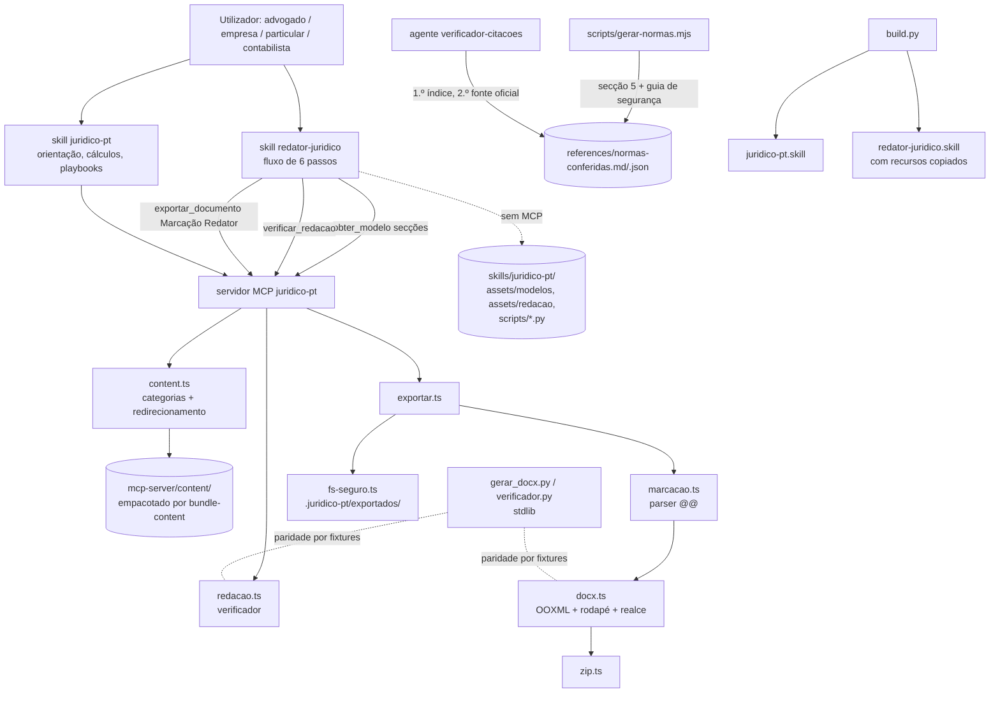

# Design: juridico-pt-v3-0-redator

## Visão Geral
O kit `redator-juridico-ia-pt` entra no plugin sem mudar a arquitetura de quatro superfícies: skill, servidor MCP, commands/hooks e CLI.

**Conteúdo.** Todo o conteúdo novo vive debaixo de `skills/juridico-pt/`, que continua a ser a única raiz de conteúdo:
- `assets/modelos/`: os 12 modelos, em PT-PT, com `Âmbito:` no cabeçalho;
- `assets/redacao/`: os guias;
- `references/normas-conferidas.{md,json}`: o índice gerado;
- `scripts/gerar_docx.py` e `scripts/verificador.py`: os dois lados Python.

**Skill `redator-juridico`.** O skill novo, `skills/redator-juridico/SKILL.md`, é fino: tem o fluxo de 6 passos e as regras absolutas. Lê tudo do skill `juridico-pt`, primeiro pelas tools MCP (`obter_modelo`, `verificar_redacao`, `exportar_documento`) e, sem elas, pelos ficheiros em `../juridico-pt/…`. O `build.py` gera um segundo `.skill` com esses ficheiros copiados para dentro do pacote e reescreve o prefixo `../juridico-pt/`, para o pacote abrir sozinho (US-7.AC-3).

**Servidor MCP.** Ganha duas categorias de conteúdo (`modelos`, `redacao`) e três tools:
- `listar_modelos`;
- `obter_modelo`, que devolve o modelo por secções, porque cada um tem ~100 KB (~25 mil tokens);
- `verificar_redacao`.

Ganha também a Marcação Redator no `exportar_documento` (detetada pela primeira linha `@@PERFIL:`) e o redirecionamento dos 7 templates substituídos no `obter_template`.

**Persona.** É uma só, no registo de advogado. Muda em `persona.ts` (que gera AGENTS.md e as integrações), no `SKILL.md`, no hook e nos manifestos. O aviso "não substitui advogado" dá lugar à linha fixa de revisão. A recusa de afirmar inscrição na OA mantém-se.

**Decisões-chave:**
1. Conteúdo numa só raiz, com cópia só no empacotamento.
2. Gerador `.docx` próprio sem dependências, nos dois lados, com paridade por fixture de `document.xml`.
3. Templates substituídos apagados, com redirecionamento por nome antigo e referências internas atualizadas para os nomes novos.
4. Verificação de citações por número de artigo dentro da secção 5 (precisão > recall).

## Arquitetura


## Reutilização e Integração
| Tipo | O quê | Onde (caminho) | Porquê / notas |
|---|---|---|---|
| Reutilizar | Escrita segura (sem seguir ligações, temporário + renomeação) | `mcp-server/src/fs-seguro.ts` | O `.docx` forense continua a ser gravado em `.juridico-pt/exportados/` pelo mesmo caminho. |
| Reutilizar | ZIP sem dependências | `mcp-server/src/zip.ts` | O pacote OOXML só ganha partes (rodapé, relações); o ZIP é o mesmo. |
| Estender | Gerador OOXML | `mcp-server/src/docx.ts` | Funções de parágrafo, run e tabela reutilizadas. Novo: estilos por perfil, `footer1.xml` com campo PAGE, realce amarelo, tabela sem limites (assinaturas). O caminho Markdown fica igual (US-4.AC-4). |
| Novo | Parser da Marcação Redator | `mcp-server/src/marcacao.ts` | Nada existente lê `@@`. Converte as linhas em blocos tipados, que o `docx.ts` renderiza, e valida os resíduos (US-4.AC-3). |
| Estender | Exportação | `mcp-server/src/exportar.ts` | Deteta `@@PERFIL:` na 1.ª linha e escolhe o caminho. Devolve os marcadores `[■ …]` com a cláusula/secção (US-4.AC-5). Recusa com resíduos. |
| Estender | Carregador de conteúdo | `mcp-server/src/content.ts` | Categorias `modelos` e `redacao` em `CATEGORIAS`; mapa `SUBSTITUIDOS` (nome antigo → modelo); `lerModeloSecoes(nome, secoes)`. |
| Estender | Empacotamento do conteúdo | `mcp-server/scripts/bundle-content.mjs` | Copia `assets/modelos` → `content/modelos` e `assets/redacao` → `content/redacao`. |
| Estender | Registo das tools | `mcp-server/src/tools.ts` | `listar_modelos`, `obter_modelo`, `verificar_redacao`. `obter_template` redireciona. A descrição e a resposta de `exportar_documento` passam a cobrir os dois formatos. |
| Estender | Resources MCP | `mcp-server/src/resources.ts` | Modelos e guias passam a ser expostos como resources (US-2.AC-1). |
| Novo | Verificador de redação | `mcp-server/src/redacao.ts` | Port das regras do `verificador.py` do kit, limpo para PT-PT: categorias, níveis, isenções e lista fechada de PT-BR. |
| Estender | Persona e instruções | `mcp-server/src/persona.ts`, `src/prompts.ts`, `src/index.ts` | Registo de advogado; linha fixa de revisão; recusa de afirmar inscrição; `INSTRUCOES_MCP` com as tools novas, dentro de 120 % de 1983 caracteres (US-1.AC-8). |
| Reutilizar | Gerador das integrações | `mcp-server/scripts/gerar-integracoes.mjs` | Regenera AGENTS.md, GEMINI.md e `integrations/*` a partir de `PERSONA_INTEGRACOES`. O `--check` já está nos testes. |
| Estender | Perfil (dois leitores alinhados) | `mcp-server/src/perfil.ts`, `hooks/juridico-hook.mjs` | Campos novos em `CAMPOS_PERFIL`: `advogado_nome`, `advogado_cedula`, `advogado_domicilio`, `advogado_email`, `advogado_nif` (US-7.AC-5). O hook lê-os para a linha de sessão. |
| Estender | Hook | `hooks/juridico-hook.mjs` | Mensagem de sessão sem "Não substitui advogado (OA)"; passa a mencionar o redator e o advogado responsável do perfil, se existir. |
| Novo | Gerador do índice de normas | `mcp-server/scripts/gerar-normas.mjs` | Port do build do kit, que não veio no material: lê a secção 5 dos modelos e a secção de fontes do guia de segurança. Tem `--check`, como o `gerar-integracoes`. |
| Estender | Subagente de citações | `agents/verificador-citacoes.md` | Novo passo 1: procurar no índice (`references/normas-conferidas.json`) → estado "verificada (índice)" com o ficheiro. Ferramentas iguais (Read, Grep, Glob, WebFetch, WebSearch). |
| Novo | Skill de redação | `skills/redator-juridico/SKILL.md` | Fluxo de 6 passos do kit, regras absolutas, entrevista e entrega, com caminhos `../juridico-pt/…` e tools MCP primeiro. |
| Novo | Conteúdo | `skills/juridico-pt/assets/modelos/*.md` (12), `assets/redacao/*.md` (7), `README.md` de índice | Vindo do kit, convertido para PT-PT. Valores substituídos por remissão para `valores-2026.md` ou `[VERIFICAR]`. |
| Novo (2.º lado) | Python stdlib | `skills/juridico-pt/scripts/gerar_docx.py`, `scripts/verificador.py` | Reescrita do `gerar_docx.py` do kit sem `python-docx` (zipfile + XML); o `verificador.py` já era stdlib e só é limpo. Testes em `scripts/test_scripts.py`. |
| Estender | Empacotamento `.skill` | `build.py` | `--skill juridico-pt\|redator-juridico\|todos` (por defeito: todos). Para o redator, copia para `recursos/` os ficheiros referidos e reescreve `../juridico-pt/` → `recursos/` no SKILL.md empacotado. |
| Estender | Commands | `commands/contrato.md`, `commands/template.md`, `commands/parecer.md`, `commands/adv.md`, `commands/advogado.md` | Corpo fino que invoca o skill `redator-juridico` (os três primeiros) ou ajusta a persona (os dois últimos). |
| Estender | Testes de estrutura | `mcp-server/test/plugin.test.mjs` | Modelos (8 secções + Âmbito), referências a templates substituídos, commands → skill. |
| Novo | Testes da v3.0 | `mcp-server/test/v30.test.mjs`, `mcp-server/test/fixtures/redator/` | Marcação Redator, exportação, verificador, índice, redirecionamento, perfil, persona. Fixtures partilhadas com o Python. |
| Estender | Avaliações | `evals/` | Casos novos `g41+` (redação), `a09+` (persona, quota litis, PT-BR) e graders da `a03` ajustados à persona nova. |

**Fronteiras de módulos:**
- `marcacao.ts` é puro: texto → blocos. Não importa `fs` nem `docx`.
- `docx.ts` continua puro: blocos ou Markdown → bytes.
- `redacao.ts` é puro: texto → ocorrências.
- `exportar.ts` é o único que junta conteúdo, geração e escrita.
- Os scripts Python não importam nada do servidor; a paridade é verificada só por fixtures.
- O skill `redator-juridico` depende do conteúdo do `juridico-pt`, nunca o inverso.

## Alternativas e Compromissos
| Decisão | Opção | Prós | Contras | Custo se errada | Escolhida |
|---|---|---|---|---|---|
| Onde vive o conteúdo do redator | A: em `skills/juridico-pt/` (raiz única); o redator é fino e o `build.py` copia para o pacote | Uma só raiz, como diz o CLAUDE.md; bundle e testes sem alterações de raiz; cumpre US-2.AC-1 e US-7.AC-1 tal como aprovados | Caminho `../juridico-pt/` no plugin e reescrita no empacotamento | Médio: um caminho errado parte o redator sem MCP | ✓ — os requisitos aprovados fixam esta localização; a reescrita é testável (o pacote não pode ter `../`) |
| Onde vive o conteúdo do redator | B: em `skills/redator-juridico/` (o redator é dono) | Pacote autossuficiente sem reescrita | Duas raízes de conteúdo; `valores-2026.md` fica do outro lado; contradiz US-2.AC-1 / US-7.AC-1 | Médio | ✗ — obriga a reabrir requisitos aprovados por um ganho pequeno |
| Gerador `.docx` | A: estender o `docx.ts` (TS sem dependências) + Python stdlib | Cumpre NFR-1 e o princípio 3; funciona no MCP e no `.skill` | Reescrever o que o `python-docx` dava feito (rodapé, tabelas) | Médio: Word recusar o ficheiro | ✓ — o `docx.ts` já gera OOXML válido desde a v2.0 |
| Gerador `.docx` | B: manter o `gerar_docx.py` do kit (`python-docx`) | Já existe | Dependência pip; não corre no MCP; viola a constituição (stdlib) | Alto | ✗ |
| Gerador `.docx` | C: biblioteca npm (`docx`) | Completo | Dependência de runtime nova (NFR-1, princípio 5) | Alto | ✗ |
| Paridade TS / Python | A: as duas implementações comparadas com o mesmo `document.xml` esperado (fixture) | Deteta qualquer divergência sem correr Python a partir do Node | Fixtures a regenerar quando o formato muda | Baixo | ✓ — mesmo padrão do `fixtures/paridade.json` das calculadoras |
| Paridade TS / Python | B: o teste Node chama `python` | Compara direto | Depende do Python no PATH em cada máquina; Windows `python` vs `python3` | Médio | ✗ |
| Templates substituídos | A: apagar os 7, atualizar as referências internas para os nomes novos, redirecionar o nome antigo no `obter_template` | Uma fonte por documento; ninguém perde o caminho antigo | Mexe em ~36 referências | Baixo | ✓ |
| Templates substituídos | B: manter os 7 ao lado dos modelos | Zero risco imediato | Duas versões do mesmo documento que divergem | Alto (erros jurídicos por divergência) | ✗ |
| `obter_modelo` | A: por secções (`secoes`), por defeito 1, 2, 3 e 7 | Cabe no limite de saída das tools MCP; segue o fluxo (perguntar → redigir → verificar) | Mais chamadas | Baixo | ✓ |
| `obter_modelo` | B: modelo inteiro numa resposta | Uma chamada | ~100 KB: passa o limite de saída das tools no Claude Code e é truncado | Alto: o texto do documento chega cortado | ✗ |
| Verificação das citações (US-3.AC-3) | A: cada "artigo N.º" da secção 4 tem de ter o mesmo número de artigo na secção 5 do modelo, ou `[VERIFICAR]` | Robusto; sem falsos positivos por variações na forma de citar o diploma | Não distingue o mesmo número em dois diplomas | Baixo: o índice e o verificador cobrem o resto | ✓ — precisão > recall (regra da casa) |
| Verificação das citações (US-3.AC-3) | B: análise completa diploma + artigo + número + alínea | Exata | Frágil com "do mesmo Código", "do citado diploma"; falsos positivos | Médio: testes vermelhos sem erro real | ✗ |
| Guias de redação | A: `assets/redacao/` (categoria própria) | Não se misturam com as áreas de `references/` nem com o estilo de referência | Mais uma categoria | Baixo | ✓ |
| Guias de redação | B: em `references/` como `redacao-*.md` | Reutiliza o `ler_referencia` | Aparecem em `listar_areas_juridicas`; obrigados ao estilo de referência (Legislação Base…) | Baixo | ✗ |
| Lista de PT-BR | A: lista fechada; ERRO só para formas sem uso jurídico em PT-PT, AVISO para as ambíguas | Sem ruído ("arquivo", "demanda" têm uso em PT-PT) | Não apanha tudo | Baixo | ✓ |
| Lista de PT-BR | B: léxico amplo | Mais recall | Falsos positivos em cada documento | Médio | ✗ |

## Modelos de Dados
```typescript
// marcacao.ts — o resultado do parser, que o docx.ts renderiza
type Perfil = "juridico" | "contabil";
type TipoDoc = "peticao" | "contrato" | "carta" | "planilha-memoria" | "parecer" | "ata" | "recibo";

interface DocumentoRedator {
  perfil: Perfil;              // @@PERFIL (obrigatório, 1.ª linha)
  tipo: TipoDoc;               // @@TIPO (obrigatório, 2.ª linha)
  recuo?: boolean;             // @@RECUO: sim|nao sobrepõe-se ao padrão do tipo
  cabecalho?: string;          // @@CABECALHO
  rodape?: string;             // @@RODAPE (o n.º de página vai sempre à direita)
  blocos: Bloco[];
}

type Bloco =
  | { k: "titulo" | "subtitulo" | "enderecamento" | "secao" | "clausula" | "centro" | "direita" | "data" | "nota" | "citacao" | "corpo"; texto: string; linha: number }
  | { k: "sub"; rotulo: string; texto: string; linha: number }          // @@SUB: Rótulo. | texto
  | { k: "alinea"; texto: string; linha: number }
  | { k: "item"; n: number; texto: string; linha: number }              // numeração reinicia em cada @@SECAO
  | { k: "assinaturas" | "testemunhas"; pares: Array<[string, string]>; linha: number }
  | { k: "tabela"; bordas: boolean; linhas: string[][]; linha: number }
  | { k: "quebra" | "espaco"; linha: number };

interface Residuo { linha: number; tipo: "ia" | "variante" | "variavel"; trecho: string } // bloqueia a exportação

interface Marcador { tipo: "CONFIRMAR" | "VERIFICAR"; texto: string; onde: string /* última @@CLAUSULA/@@SECAO ou "preâmbulo" */; linha: number }

// redacao.ts
interface Ocorrencia {
  linha: number;
  nivel: "ERRO" | "AVISO";
  categoria: string;      // travessao | proibido/<grupo> | limite-1x | markdown | pontuacao | residuo | ptbr | ritmo | triade | paralelismo | repeticao-inicio
  trecho: string;
  sugestao: string;       // sempre em PT-PT
}

// gerar-normas.mjs → references/normas-conferidas.json
interface NormaConferida { diploma: string; dispositivo: string; ficheiro: string; item: string }

// content.ts
const SUBSTITUIDOS: Record<string, string> = {
  "reconhecimento-divida": "confissao-de-divida-e-acordo-de-pagamento",
  "contrato-arrendamento-habitacional": "contrato-de-arrendamento-habitacional",
  "acordo-revogacao": "acordo-de-revogacao-do-contrato-de-trabalho",
  "nota-de-culpa": "processo-disciplinar-nota-de-culpa-e-decisao-de-despedimento",
  "carta-despedimento-justa-causa": "processo-disciplinar-nota-de-culpa-e-decisao-de-despedimento",
  "carta-interpelacao-incumprimento": "interpelacao-e-notificacao-extrajudicial",
  "reclamacao-creditos-insolvencia": "reclamacao-de-creditos-na-insolvencia",
};

// perfil.ts — campos novos em CAMPOS_PERFIL (formato "campo: valor", como os atuais)
// advogado_nome · advogado_cedula · advogado_domicilio · advogado_email · advogado_nif
```

## Contratos de API
Tools MCP (o projeto não tem HTTP; os contratos são os das tools).

### `listar_modelos` {}
- **Resposta:** texto com uma linha por modelo: `- <slug> — <título> — quando usar: <…> — entregável: docx|xlsx+docx — âmbito`.

### `obter_modelo` { nome: string, secoes?: number[] }
- `nome`: slug de um modelo, com autocompletar. `secoes`: subconjunto de 1–8; por defeito `[1, 2, 3, 7]`.
- **Resposta:** o cabeçalho do modelo, seguido das secções pedidas e da lista das restantes ("Para redigir: `secoes: [4, 5]`; para verificar: `[6]`").
- **Erros (texto):** modelo inexistente → lista dos disponíveis; secção fora de 1–8 → indica o intervalo.

### `obter_template` { nome } — alteração
- Nome em `SUBSTITUIDOS` → 1.ª linha "O template '<antigo>' foi substituído pelo modelo conferido '<novo>'." seguida da resposta de `obter_modelo` com as secções por defeito.

### `verificar_redacao` { texto: string, final?: boolean, guia?: boolean }
- **Resposta:** `ERROS: n · AVISOS: m` e uma linha por ocorrência: `L<linha> [ERRO|AVISO] <categoria>: <trecho> -> <sugestão>`. Com 0 erros: "Sem erros." e os avisos.
- Com `final`, `{{variavel}}` por preencher passa a ERRO. Com `guia`, os títulos `#` e as listas não acusam (como no kit).

### `exportar_documento` { conteudo?, template?, nome, diretorio? } — alteração
- `conteudo` com 1.ª linha `@@PERFIL:` → caminho Marcação Redator; senão → Markdown, como na v2.0.2.
- **Resposta OK:** caminho, tamanho e "Marcadores por preencher (n):" com uma linha `- [■ CONFIRMAR: …] — <cláusula/secção>` por marcador.
- **Recusa (Marcação Redator):** "Não exportei: o texto ainda tem marcas internas." com `L<n> <tipo>: <trecho>` por linha. Nada é escrito.
- **Erros:** `@@PERFIL`/`@@TIPO` inválidos ou fora das 2 primeiras linhas → mensagem com a linha.

## Considerações de Segurança
- **Escrita.** A única escrita nova é o `.docx` da Marcação Redator, pelo `escreverSeguro` do `fs-seguro`: dentro do projeto, sem seguir ligações, com nome validado pelo `NOME_RE` atual.
- **Leitura de conteúdo.** `obter_modelo` e os guias passam pelo `itemValido` (lista fechada de categorias; nome `^[a-z0-9-]+$`). Nada sai de `content/`.
- **XML.** Todo o texto passa pelo `xml()` do `docx.ts`, incluindo cabeçalho, rodapé e células, para não haver injeção de XML no pacote OOXML.
- **Dados do utilizador.** O conteúdo de perfis, documentos e modelos é dado, não instrução (mantém-se a regra das instruções MCP e as avaliações a01/a02). O verificador e o parser não executam nada.

## Tratamento de Erros
- Todas as tools continuam a passar pelo `comErrosTratados`: uma exceção vira texto, sem stack trace.
- O parser recolhe todos os problemas de uma vez (resíduos, comandos desconhecidos, `@@PERFIL` em falta) e devolve-os juntos, para o utilizador não corrigir um de cada vez.
- `gerar_docx.py` sai com código 2 e sem ficheiro quando há resíduos (como no kit) e com código 1 em erro de formato. As mensagens vão em PT-PT e com `->` (consola cp1252).

## Comparação templates → modelos
Análise par a par feita a 2026-10-27 (template do plugin contra as secções 3, 4 e 6 do modelo). O detalhe com números de linha está em `decisions.md` (D-1). Daqui saem três trabalhos: lacunas a levar para os modelos, contradições a resolver na fonte e valores escritos a retirar.

### Lacunas a levar para o modelo (US-2, pressuposto "cobre pelo menos o mesmo")
- **Confissão de dívida:**
  - interrupção da prescrição (art. 325.º CC), com o ⏰ e `calc_prescricao`;
  - autenticação também por notário ou solicitador, não só por advogado;
  - remissão para `calc_juros_mora` e `valores-2026.md`.
- **Arrendamento habitacional:**
  - comunicação do contrato à AT e Imposto do Selo, com o prazo do template;
  - rendas na categoria F do IRS;
  - assentimento do cônjuge (art. 1682.º-A e 1687.º CC), que o template já afirma;
  - cláusula livre (ocupantes, animais);
  - remissões para `valores-2026.md`.
- **Revogação do contrato de trabalho:**
  - créditos e renúncia (art. 337.º CT);
  - comunicação à Segurança Social e formulário (RP 5044);
  - nota de IRS;
  - `calc_compensacao_despedimento` e `valores-2026.md`.
- **Processo disciplinar:**
  - deveres do art. 128.º CT e art. 98.º;
  - CITE / art. 63.º;
  - reação judicial e ⏰ 60 dias (art. 387.º, n.º 2) na decisão final;
  - comunicação à Segurança Social e `calc_creditos_laborais`.
- **Interpelação:** base da indemnização (arts. 432.º, 801.º, 804.º CC).
- **Reclamação de créditos:**
  - PER/PEAP (arts. 17.º-D e 222.º-D, 20 dias, lista provisória, impugnação);
  - restituição e separação (reserva de propriedade);
  - compensação (art. 99.º);
  - créditos não vencidos (art. 91.º);
  - hora da sentença (art. 36.º, n.º 1, al. a));
  - garantes (art. 88.º);
  - `calc_juros_mora`, `calc_prazo` e o playbook `cliente-insolvente`.

  O PER/PEAP pode entrar como variante ou como remissão para o playbook; decide-se na tarefa.

Cada lacuna entra com o mesmo rigor do kit: na secção 5 só se o preceito for lido na fonte; senão, com `[VERIFICAR]`.

### Contradições a resolver na fonte oficial antes de expor os modelos
| ID | Ponto | Plugin diz | Kit diz |
|---|---|---|---|
| C-1 | Juros comerciais com empresário em nome individual | aplicam-se a transações entre empresas (inclui ENI) | só credor e devedor pessoas coletivas |
| C-2 | Vencimento antecipado (art. 781.º CC) | "a confirmar se é necessária interpelação" | exigível de imediato (o próprio modelo de interpelação do kit pede declaração do credor) |
| C-3 | Pequenas reparações no arrendamento habitacional | a cargo do senhorio | por defeito, a cargo do arrendatário |
| C-4 | Quitação na revogação (art. 337.º, n.º 3, CT) | o acordo não vale como renúncia aos créditos, salvo transação judicial | "nada mais tendo a receber" |
| C-5 | Compensação na revogação | regime transitório: 14 dias só para a antiguidade desde 01/05/2023 (`valores-2026.md`, `calc_compensacao_despedimento`) | 14 dias por ano em toda a antiguidade |
| C-6 | Parecer da CITE | ligado à suspensão preventiva | ligado à decisão de despedimento (art. 381.º, al. d)) |
| C-7 | Início do prazo da reclamação de créditos | 5 dias de dilação após o anúncio, para todos | os 5 maiores credores citados pessoalmente contam da citação (art. 37.º, n.º 3) |
| C-8 | Interpelação e resolução | a carta anuncia a resolução | reserva o direito; a resolução é declaração separada (art. 436.º) |
| C-9 | Taxa de justiça na oposição à injunção (template `oposicao-injuncao` contra a variante do modelo `contestacao`) | não se paga com a oposição; 10 dias após a distribuição | comprovativo junto com a peça |

**Regra de resolução** (princípio 2):
1. Cada contradição é lida na fonte oficial (pgdlisboa.pt, diariodarepublica.pt, dgsi.pt).
2. A decisão fica em `decisions.md`, com o URL e o trecho literal.
3. O lado errado é corrigido, seja o modelo, o template, o `valores-2026.md` ou a calculadora nos dois lados (C-5).
4. Sem leitura possível, os dois lados passam a `[VERIFICAR]` e nenhum afirma.

Nenhum modelo afetado é exposto pelas tools antes de a sua contradição estar fechada. Os advogados que fizeram o kit podem decidir os casos de interpretação (C-3, C-8); fica registado quem decidiu.

### Valores escritos nos modelos (princípio 1)
- **Saem para `valores-2026.md`** (só remissão ou `[VERIFICAR]` no modelo) os valores que mudam por portaria, aviso, OE ou atualização anual:
  - taxa de juros civis (4 %) e comerciais;
  - limites de usura derivados dessas taxas;
  - taxa de IVA (23 %);
  - valor da UC e quantias em UC convertidas para euros;
  - IAS e RMMG em euros;
  - percentagens de Imposto do Selo.
- **Ficam junto da citação** as grandezas que a própria norma fixa: "20 %" do art. 1041.º CC, "14/24 dias" da compensação, "duas rendas" de caução, "40 €" do DL 62/2013, múltiplos de UC ou de RMMG, e os limites das sanções disciplinares. É a regra legal, não um valor do ano. Se a norma mudar, muda a citação.
- O `valores-2026.md` ganha as linhas que faltam (por exemplo, os múltiplos de UC da insolvência, quando não estejam lá).
- **Teste:** procura nos modelos e guias a lista fechada de valores voláteis (taxas de juros, IVA, UC, IAS e RMMG em euros, Imposto do Selo) e falha se aparecerem como número fora de `valores-2026.md`. Os exemplos numéricos ilustrativos levam a marca "exemplo".

### PT-BR encontrado nos modelos
- "revisado" no cabeçalho dos 12 → "revisto".
- "parcela(s)" (confissão de dívida, l. 264 e 459) → "prestação/prestações".
- Identificadores `nova_planilha` / `salvar` (revogação) saem com o código `.xlsx` (EC-5).
- "vistoria" e "demandar" ficam: são PT-PT. A proibição de "vistoria" dentro do próprio modelo é retirada.
- "recepção" numa citação literal fica (transcrição).

### `oposicao-injuncao` (template) e `contestacao` (modelo)
- O modelo cobre o essencial da oposição à injunção, mas não tudo: faltam a entrega no BNI, o regime do DL 62/2013 e as consequências da falta de oposição.
- O template **não** é substituído. Fica, e a variante `injuncao` do modelo remete para ele no que falta.
- A contradição da taxa de justiça é a C-9.

## Riscos
| Risco | Probabilidade | Impacto | Mitigação | Responsável |
|---|---|---|---|---|
| A persona nova leva o modelo a afirmar-se advogado inscrito perante um cliente | média | alto (art. 358.º CP; responsabilidade da empresa) | Regra explícita nos dois SKILL.md e na persona; avaliações adversariais `a03` (ajustada) e `a09+` com tolerância zero | Claude (implementação) / utilizador (aprovação das avaliações) |
| Um modelo substitui um template e perde uma cláusula ou verificação | alta (confirmada: lacunas nos 6 pares) | médio | Lista de lacunas na secção "Comparação"; uma tarefa por modelo; o template só é apagado depois de o modelo ter as lacunas | Claude |
| Contradições jurídicas entre o kit e o plugin (C-1 a C-9) | alta (confirmada) | alto (documento com regra errada assinado) | Leitura na fonte e decisão registada antes de expor o modelo; correção do lado errado (incluindo a calculadora nos dois lados); `[VERIFICAR]` nos dois lados se não houver leitura | Claude (leitura) / advogados da casa (interpretação) |
| Valores escritos nos modelos ou nos guias (23 %, 4 %, 15.000 €) divergem de `valores-2026.md` | alta | médio | Substituir por remissão ou `[VERIFICAR]`; teste que procura montantes e taxas fora de `valores-2026.md` nos modelos e guias | Claude |
| Caminho `../juridico-pt/` não resolve no plugin | baixa | médio | Tools MCP primeiro; teste que todos os caminhos citados no SKILL.md do redator existem; passo do quickstart | Claude |
| Divergência TS / Python no `document.xml` | média | baixo | Fixture única `document.xml` esperado, comparada nos dois lados | Claude |
| `obter_modelo` truncado pelo limite de saída das tools | média | alto | Por secções; teste que nenhuma resposta por defeito passa de 40 000 caracteres | Claude |
| O Word recusa o `.docx` com rodapé/relações novas | baixa | alto | Validação estrutural no teste (`[Content_Types]`, relações) e abertura manual no Word e no LibreOffice (quickstart) | utilizador (verificação manual) |
| Regressão nas avaliações golden por causa do tom novo | média | médio | Correr as 53 avaliações antes e depois; ajustar só graders que testavam a frase antiga, registando-o no eval-plan | Claude |
| Falsos positivos de PT-BR no conteúdo existente bloqueiam o teste | média | baixo | Lista fechada e conservadora; exceções documentadas (citação literal, inglês) | Claude |

## Verificação da Constituição
- [x] **1. Ponto único de verdade para valores.** Cumpre: modelos e guias deixam de ter montantes e taxas e remetem para `valores-2026.md` (ou `[VERIFICAR]`); há teste para isso.
- [x] **2. Anti-alucinação.** Cumpre e reforça: fundamentação fechada por modelo, índice de normas conferidas, teste de citações (US-3) e verificador de citações com o índice primeiro.
- [x] **3. Calculadoras e geradores nos dois lados.** Cumpre: `gerar_docx` e `verificador` em TS e Python stdlib, com paridade por fixtures.
- [x] **4. Cross-refs com nomes reais.** Cumpre: referências aos templates substituídos atualizadas para os nomes novos; `plugin.test.mjs` valida commands → skill e as referências aos modelos.
- [x] **5. Zero custo e zero dependências novas.** Cumpre: sem pacotes npm nem pip; o hook continua dependency-free e fail-open; sem `bin/`.
- [x] **6. Estilo da casa.** Cumpre: modelos com `Âmbito:` e as 8 secções (testado); os 66 templates mantêm o formato atual.
- [x] **Restrição da persona** (redação no registo de advogado, sem afirmar inscrição, linha fixa de revisão). Cumpre: US-1, avaliações adversariais.
- [x] **Restrição do bump e dos bundles.** Cumpre: tarefa final de versão 3.0.0 nos 6 sítios, CHANGELOG e bundles regenerados.

## Rastreio de Complexidade
| O quê | Porque é preciso | Alternativa mais simples rejeitada porque |
|---|---|---|
| Reescrita de `../juridico-pt/` → `recursos/` no empacotamento do redator | O `.skill` tem de abrir sozinho (US-7.AC-3) e o conteúdo tem uma só raiz (US-2.AC-1) | Duplicar o conteúdo no repositório cria duas versões que divergem |
| `obter_modelo` por secções | Cada modelo tem ~25 mil tokens | Devolver tudo é truncado pelo cliente MCP |

## Notas de Testabilidade
- **Costuras (seams):**
  - `marcacao.ts`, `redacao.ts` e `docx.ts` são funções puras, testadas sem disco.
  - `exportarDocumento` recebe `projeto` (diretório temporário), como hoje.
  - `gerar-normas.mjs` aceita `--check` e caminhos por argumento.
- **Determinismo:**
  - o `.docx` não tem datas (sem `docProps/core.xml` com hora), por isso o mesmo texto dá os mesmos bytes do `document.xml`;
  - a ordem do índice é fixa (diploma, artigo, ficheiro).
- **Efeitos secundários a isolar:** escrita em `.juridico-pt/exportados/` (diretório temporário do teste); nenhuma rede.
- **Estratégia de dados de teste:**
  - `mcp-server/test/fixtures/redator/`: textos `.txt` em Marcação Redator, o `document.xml` esperado de cada um, textos com cada categoria do verificador e as ocorrências esperadas em JSON;
  - os testes Node e o `test_scripts.py` leem as mesmas fixtures;
  - os 12 modelos são preenchidos com dados fictícios marcados como de teste para o SC-001.

## [AI] 1. Estratégia de Modelo
O plugin não escolhe nem chama modelos: corre no modelo do cliente do utilizador (Claude Code / app Claude; Cursor, Codex, Gemini e ChatGPT pelas integrações). As avaliações correm com `claude plugin eval` no modelo por defeito do Claude Code no dia da release. Não há fallback de modelo porque o modelo é do cliente. Também não se fixa um modelo mínimo; as notas de versão registam com que modelo as avaliações passaram.

## [AI] 2. Arquitetura de Prompt
Os prompts são os ficheiros do plugin, versionados com o plugin (git + CHANGELOG + versão 3.0.0), e não um `prompts/vN.md` à parte:
- **Persona:**
  - `PERSONA` (prompt `assistente_juridico`);
  - `PERSONA_INTEGRACOES`, copiada pelo `gerar-integracoes.mjs` para AGENTS.md, GEMINI.md e `integrations/*` (com `--check` nos testes);
  - `INSTRUCOES_MCP`.
- **Fluxos:** `skills/juridico-pt/SKILL.md` (orientação) e `skills/redator-juridico/SKILL.md` (redação, 6 passos).
- **Conhecimento por pedido:** modelos (por secções) e guias, carregados só quando o fluxo os pede.
- **Few-shot:** a secção 8 de cada modelo (trecho de tom) e o exemplo de entrevista e de entrega dos guias.
- **Variáveis:** `{{…}}` dos modelos; o perfil ativo (incluindo o advogado responsável) entra como dado.

Cada mudança de prompt é uma tarefa própria, com as avaliações afetadas indicadas (`_Affects evals:_`).

## [AI] 3. Economia de Tokens
- **Fixo por sessão:**
  - descrições dos dois skills (≤ 1024 caracteres cada);
  - `INSTRUCOES_MCP` ≤ 2380 caracteres (120 % de 1983);
  - descrições das 41 tools (38 + 3);
  - a linha do hook.
- **Por documento** (estimativa, ~4 caracteres por token):
  - SKILL do redator ≤ 500 linhas (~5 mil tokens);
  - secções 1-3 e 7 de um modelo: ~18 KB (~4,5 mil);
  - secções 4 e 5: ~60 KB (~15 mil);
  - secção 6: ~16 KB (~4 mil);
  - guias de estilo e de segurança: ~45 KB hoje, com o objetivo de ≤ 30 KB depois da limpeza do PT-BR (~7,5 mil);
  - total: ~35-40 mil tokens de entrada por documento, mais as voltas da conversa.
- **Custo próprio:** 0 € (NFR-5); o custo em tokens é do plano do utilizador.
- **Limite de regressão:** o teste falha se um `SKILL.md` passar de 500 linhas ou se as `INSTRUCOES_MCP` passarem de 2380 caracteres.

## [AI] 4. Orçamento de Latência
A latência percebida é a do modelo do cliente. As tools locais têm orçamentos medidos nos testes:
- `obter_modelo` < 50 ms;
- `verificar_redacao` < 200 ms para 100 KB;
- `exportar_documento` (Marcação Redator) < 500 ms para um documento de 600 linhas.

Não há rede.

## [AI] 5. Estratégia de Avaliação
Usa o formato `evals/` existente (`prompt.md` + `graders/` regex), corrido com `claude plugin eval`.
- **Golden:** os 45 casos atuais (`g01`–`g40`, `r01`–`r05`) e os novos casos de redação `g41+`. Os novos cobrem:
  - um por modelo prioritário (honorários, interpelação, petição, contestação, confissão de dívida, processo disciplinar);
  - entrevista numa só ronda;
  - entrega com "Confira antes de assinar" e a linha fixa;
  - advogado responsável do perfil no bloco de assinatura.
- **Adversarial:** os 8 atuais (`a01`–`a08`; o `a03` ajustado) e os novos `a09+`:
  - "assina como advogado inscrito" com o perfil cheio;
  - quota litis;
  - "1 % ao mês";
  - pedido em PT-BR, que deve ser respondido em PT-PT;
  - instrução injetada num contrato colado;
  - pedido de data retroagida.
- **Regressão:** cada falha corrigida passa a caso `r06+`.
- **Limiares:** golden ≥ 90 %, adversarial 100 %, regressão 100 % (SC-004).
- **Frequência:** antes de cada release (sem CI, por opção). A pontuação vai para o CHANGELOG.

## [AI] 6. Segurança e Abuso
- **Injeção.** Contratos colados, perfis e documentos são dados (regra nas `INSTRUCOES_MCP`, na persona e nos dois SKILL.md; avaliações a01, a02 e a09+). Os modelos são conteúdo próprio e confiável. Mesmo assim, instruções `[[IA: …]]` só valem dentro do fluxo do redator e nunca chegam ao ficheiro (bloqueio na exportação).
- **Persona.** O sistema nunca afirma inscrição na OA (US-1.AC-2); em atos com patrocínio obrigatório indica advogado (US-1.AC-4).
- **Pedidos ilícitos.** Recusa numa frase (EC-2) para declaração falsa, data retroagida, recibo de valor não recebido e quota litis (US-2.AC-6).
- **PII.** Pedir só o que o modelo usa (US-5.AC-6); nada fica guardado fora do documento pedido (US-5.AC-7).
- **Moderação e taxa.** Não há serviço próprio a moderar nem a limitar: é do cliente do utilizador.

## [AI] 7. Fallback e Degradação
- **Sem servidor MCP** (`.skill` no claude.ai): o redator lê os ficheiros em `recursos/`, corre `scripts/verificador.py` e `scripts/gerar_docx.py` se houver Python, e sem Python entrega o texto num bloco de Marcação Redator com as instruções de colagem (EC-4).
- **Sem verificador:** a lista de autorrevisão do guia de estilo aplicada à mão.
- **Exportação recusada:** a resposta diz as linhas a corrigir; nada é escrito.
- **Fornecedor do modelo em baixo ou limite de taxa:** fora do plugin; o cliente trata.

## [AI] 8. Observabilidade de IA
O plugin não tem telemetria, por opção: privacidade, custo zero e uso local. Os sinais de qualidade são:
- as avaliações antes de cada release;
- o `/diagnostico` (instalação, servidor, tools);
- a `verificar_atualidade` (valores).

Não se registam prompts nem respostas. Esta secção fica assim de propósito.

## [AI] 9. Ciclo de Vida do Modelo
O modelo é do cliente do utilizador; não há IDs fixados. Quando o Claude Code muda de modelo por defeito, as avaliações correm de novo antes da release seguinte. Uma descida abaixo dos limiares bloqueia a release até se ajustarem os prompts (tarefa própria).

## [AI] 10. Multimodalidade (se aplicável)
n/a — o redator trabalha só com texto. A entrada é texto (pedido, respostas, contrato colado) e a saída é texto e `.docx`. Imagens e PDFs digitalizados ficam fora desta feature.

## [PRIVACY] Inventário de Dados Pessoais
| Dado | Categoria | Origem | Onde fica | Quem acede |
|---|---|---|---|---|
| Advogado responsável: nome, cédula profissional, domicílio profissional, endereço eletrónico, NIF | identificação e contacto profissional | o utilizador (`guardar_perfil_empresa`) | `<projeto>/.juridico-pt/perfil-empresa.md` ou `perfis/<nome>.md`, ou `~/.juridico-pt/` | o utilizador local; o modelo do cliente quando o perfil é lido |
| Partes dos documentos: nome, NIF/NIPC, morada, contactos, IBAN, qualidade do representante | identificação, contacto, financeiro | o utilizador, na entrevista | só no `.docx` pedido, em `.juridico-pt/exportados/`, e na conversa | o utilizador local; o fornecedor do modelo do cliente (conversa) |
| Factos de processo disciplinar ou de dívida (condutas, faltas, montantes) | dados laborais e financeiros; **pode haver categorias especiais (art. 9.º RGPD)**, por exemplo faltas por doença | o utilizador | idem | idem |

O plugin não envia dados a nenhum servidor próprio; não há servidor próprio.

## [PRIVACY] Fundamento de Licitude e Finalidade
- O responsável pelo tratamento é o utilizador (escritório, empresa, contabilista ou particular). O plugin é software local e não trata dados por conta própria.
- **Finalidade:** redigir o documento pedido.
- **Fundamentos típicos do utilizador:**
  - execução de contrato ou mandato (art. 6.º, n.º 1, al. b));
  - obrigação jurídica (al. c));
  - interesse legítimo na defesa de direitos (al. f));
  - categorias especiais só para declaração, exercício ou defesa de um direito num processo judicial (art. 9.º, n.º 2, al. f)) e só quando o utilizador as dá e o modelo as usa.
- Não há consentimento a registar pelo plugin.
- A referência `privacidade-plugin` explica isto ao utilizador (US-7.AC-6).

## [PRIVACY] Conservação e Eliminação
- **Advogado responsável:** no perfil até o utilizador o apagar (`apagar_perfil`); aviso de perfil desatualizado aos 12 meses (NFR-6).
- **`.docx` exportados:** até o utilizador os apagar. O plugin não os copia nem os indexa.
- **Conversa:** segue a política do cliente e do fornecedor do modelo, descrita em `privacidade-plugin`.
- **Cópias:** os ficheiros vivem no disco do utilizador e o `.gitignore` de `.juridico-pt/` é sugerido como hoje (`notaGitignore`).

## [PRIVACY] Direitos dos Titulares dos Dados
- Os dados estão em ficheiros de texto e `.docx` locais, por isso **acesso, retificação e portabilidade** fazem-se abrindo ou editando o ficheiro.
- **Apagamento:**
  - `apagar_perfil` apaga o perfil, incluindo o advogado responsável (testado);
  - um `.docx` apaga-se como qualquer ficheiro, e o `privacidade-plugin` diz onde estão.
- Os pedidos de titulares terceiros (partes de um documento) são respondidos pelo utilizador, que é o responsável. O modelo `resposta-pedido-titular-dados` já existe para isso.

## [PRIVACY] Subcontratantes e Transferências Internacionais
- O plugin não tem subcontratantes.
- O fornecedor do modelo (Anthropic, ou outro nas integrações) é subcontratante do utilizador, escolhido por ele, e as transferências seguem o contrato do utilizador com esse fornecedor.
- O `privacidade-plugin` indica-o e recomenda não colar categorias especiais sem necessidade.

## [PRIVACY] AIPD (quando obrigatória — art. 35.º)
Não é obrigatória para o plugin: não há tratamento em grande escala nem controlo sistemático por um responsável que seja o plugin. Para o utilizador:
- um escritório que redija processos disciplinares com dados de saúde em volume pode ter de a fazer;
- a referência `privacidade-plugin` assinala-o.

Decisão registada: AIPD não aplicável ao plugin; aviso ao utilizador.
