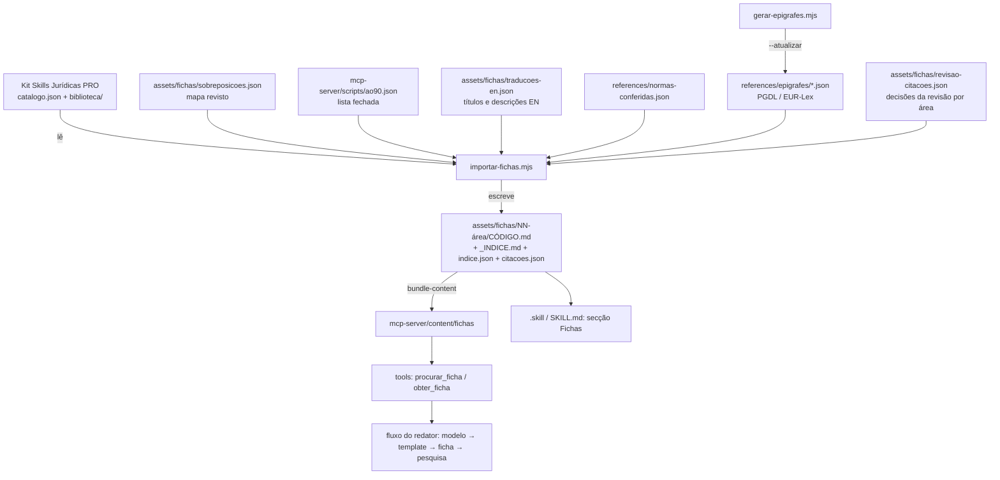

# Design: juridico-pt-v3-1-fichas

## Visão Geral
O kit entra como uma quarta camada de conteúdo do skill `juridico-pt`, ao lado dos modelos conferidos, dos templates e dos playbooks e checklists. Fica em `assets/fichas/` e o assistente lê-o a pedido. Não entra como 1319 skills: cada skill carrega a sua descrição em todas as sessões, e 1319 descrições rebentavam o orçamento de contexto.

A importação é feita por um script node reexecutável (`importar-fichas.mjs`), que segue sempre o mesmo pipeline:
1. ler o catálogo;
2. aplicar o mapa de sobreposições;
3. normalizar a grafia e a persona;
4. extrair as citações e conferi-las;
5. juntar as traduções EN;
6. escrever as fichas e os índices.

O mesmo script com `--check` compara o resultado com o que está versionado.

As epígrafes oficiais dos 25 diplomas principais ficam versionadas em `references/epigrafes/`. Servem ao importador para conferir as citações e servem também ao `verificador-citacoes`.

**Decisões-chave:**
- Uma só raiz de conteúdo. As tools servem as fichas e o `.skill` leva-as; não há cópia manual (a cópia em `content/` é feita pelo `bundle-content`).
- As fichas `mesmo-documento` não entram e ficam como remissão. Os modelos conferidos e os templates têm prioridade.
- Uma citação nunca é dada como conferida sem prova (índice de normas ou epígrafe confirmada). O resto sai com `[■ VERIFICAR]`.
- O inglês fica no índice. O corpo das fichas fica em PT-PT.

## Arquitetura


## Reutilização e Integração
| Tipo | O quê | Onde (caminho) | Porquê / notas |
|---|---|---|---|
| Reutilizar | Normalização de diplomas (`canonDiploma`) e extração de dispositivos | `mcp-server/scripts/gerar-normas.mjs` | Exporta-se e reutiliza-se para extrair as citações das fichas com as mesmas regras do índice. |
| Reutilizar | Listas de PT-BR (ERRO) do verificador | `mcp-server/src/redacao.ts` | O teste de grafia das fichas usa a mesma lista fechada que os modelos. |
| Estender | Categorias de conteúdo e leitura | `mcp-server/src/content.ts` | Categoria nova `fichas`, mais o índice em memória para a pesquisa. Não mexe nas categorias atuais. |
| Estender | Registo das tools | `mcp-server/src/tools.ts` | Tools novas `procurar_ficha` e `obter_ficha`. As 41 tools atuais mantêm-se. |
| Estender | Cópia do conteúdo para o servidor | `mcp-server/scripts/bundle-content.mjs` | Passa a copiar também `assets/fichas`. |
| Estender | Persona e instruções do servidor | `mcp-server/src/persona.ts` | Passam a nomear as tools novas e a ordem modelo → template → ficha, dentro dos 2000 caracteres. |
| Estender | Fluxo do redator | `skills/juridico-pt/assets/redacao/redator.md` | O passo 1 ganha a ficha antes do protocolo de pesquisa. |
| Estender | Skill | `skills/juridico-pt/SKILL.md` | Secção curta "Fichas do catálogo", que também explica o uso sem MCP. |
| Estender | Verificador de citações | `agents/verificador-citacoes.md` | Passo 1b: as epígrafes versionadas antes de ir à fonte. |
| Novo | Importador | `mcp-server/scripts/importar-fichas.mjs` | Nada do que existe importa conteúdo de fora com normalização e conferência. Pesquisei: o `gerar-normas` só indexa. |
| Novo | Gerador de epígrafes | `mcp-server/scripts/gerar-epigrafes.mjs` | Não havia epígrafes locais. O verificador ia sempre à rede. |
| Novo | Lista AO90 | `mcp-server/scripts/ao90.json` | O verificador só tem PT-BR. A grafia anterior ao AO90 não existia como regra. |
| Novo | Fichas, índices, mapa de sobreposições, traduções EN, revisão de citações | `skills/juridico-pt/assets/fichas/` | Conteúdo novo. |

**Fronteiras de módulos:**
- Os scripts de importação só correm em build e manutenção. O servidor nunca os importa.
- O servidor só lê `content/fichas/indice.json` e as fichas, que são texto.
- O `.skill` leva as fichas e os `_INDICE.md`.

## Alternativas e Compromissos
| Decisão | Opção | Prós | Contras | Custo se errada | Escolhida |
|---|---|---|---|---|---|
| Forma de integrar | 1319 skills (o `claude-skills/` do kit) | Ativação direta por pedido | 1319 descrições em todas as sessões rebentam o contexto e a listagem fica truncada | Plugin lento e skills que não ativam | ✗ |
| Forma de integrar | Fichas a pedido com 2 tools e índices | Contexto fixo quase igual; uma só raiz | Precisa de tools e de índice | Baixo | ✓ — é o padrão dos modelos (`obter_modelo`) |
| Sobreposições | Importar tudo e marcar duplicados | Nada se perde | Duas versões do mesmo documento | Respostas contraditórias | ✗ |
| Sobreposições | Não importar `mesmo-documento` e deixar remissão | Um documento, um sítio | Exige um mapa revisto à mão | Médio (mapa errado) — mitigado por teste e revisão | ✓ |
| Grafia | Converter por regras de morfologia (cç→ç, ct→t) | Cobre tudo | Estraga formas que o AO90 mantém em PT (facto, contacto, secção, pacto) | Alto | ✗ |
| Grafia | Lista fechada de formas, revista, com teste | Previsível, auditável | Exige rever a lista | Baixo | ✓ |
| Citações | Confiar no kit | Zero trabalho | 3 em 5 erradas na amostra | Muito alto (peças com artigos errados) | ✗ |
| Citações | Cruzar com o índice e as epígrafes; revisão por área; o resto `[■ VERIFICAR]` | Nenhuma citação passa como certa sem prova | Exige trabalho de revisão | Médio | ✓ |
| Inglês | Traduzir as 1319 fichas | Tudo em EN | ~8 MB a manter em duas línguas; o direito é português | Alto (divergências) | ✗ |
| Inglês | Índice bilingue; resposta na língua do utilizador | Pesquisa em EN; uma só fonte do conteúdo | O corpo da ficha fica em PT | Baixo | ✓ |
| Epígrafes | Ir sempre à rede (WebFetch) | Sempre atual | Lento e frágil; resumos de modelo pequeno | Médio | ✗ |
| Epígrafes | Versionar as epígrafes dos 25 diplomas, com `--atualizar` | Determinístico e testável | Revisão anual | Baixo | ✓ |

## Modelos de Dados
```typescript
// assets/fichas/indice.json — uma entrada por ficha importada, mais as remissões
interface EntradaIndice {
  codigo: string;            // "FAM-012"
  area: string;              // "Direito da Família e das Crianças"
  pasta: string;             // "06-direito-da-familia-e-das-criancas"
  ficheiro: string | null;   // caminho relativo a assets/fichas; null nas remissões
  titulo: string; titulo_en: string;
  descricao: string; descricao_en: string;
  estado: { conferidas: number; corrigidas: number; por_conferir: number }; // contagens de citações
  remete_para?: string;      // "assets/modelos/reclamacao-de-creditos-na-insolvencia" (mesmo-documento ou complementa)
  relacao?: "mesmo-documento" | "complementa";
}

// assets/fichas/sobreposicoes.json — revisto; o importador falha se um código não existir
type Sobreposicoes = Record<string, { relacao: "mesmo-documento" | "complementa"; alvo: string; nota?: string }>;

// references/epigrafes/<sigla>.json
interface Epigrafes { sigla: string; diploma: string; fonte: string; url: string; obtido_em: string; artigos: Record<string, string> } // "153" -> "Forma e conteúdo de contrato de trabalho a tempo parcial"

// assets/fichas/revisao-citacoes.json — decisões da revisão por área (o importador aplica-as)
type Revisao = Record<string /*codigo*/, Array<{ citacao: string; decisao: "conferida" | "corrigir" | "verificar"; correto?: string; nota?: string }>>;

// assets/fichas/citacoes.json — relatório gerado
interface Citacao { codigo: string; texto: string; diploma: string | null; artigo: string | null; estado: "conferida (índice)" | "conferida (epígrafe)" | "corrigida" | "por conferir"; epigrafe?: string; nota?: string }
```

## Contratos de API
### Tool `procurar_ficha`
- **Entrada:** `{ termo?: string; area?: string }`. Pelo menos um dos dois. `area` aceita a sigla (FAM) ou parte do nome.
- **Saída:** até 20 linhas `CÓDIGO — título PT / título EN — área — citações: N conferidas, M por conferir`, seguidas das remissões `CÓDIGO → usa assets/modelos/x (modelo conferido)` quando o termo bate num código ou título `mesmo-documento`. A pesquisa é por pontuação de palavras em títulos e descrições PT e EN, sem acentos e sem maiúsculas, com o título a pesar mais.
- **Erros:** sem termo e sem área devolve a lista das 22 áreas com as contagens.

### Tool `obter_ficha`
- **Entrada:** `{ codigo: string }`.
- **Saída:** um cabeçalho fixo e a seguir a ficha. O cabeçalho tem o estado das citações, a ordem modelo → template → ficha, os valores em `valores-2026` e o fluxo do redator. Na ficha, as citações `por conferir` aparecem com `[■ VERIFICAR]`. Um código `mesmo-documento` devolve só a remissão.
- **Erros:** um código inexistente devolve "Não há a ficha X. As mais próximas: …" com 5 sugestões.

## Considerações de Segurança
- As fichas são texto da empresa, mas tratam-se como dados, como já acontece com perfis e modelos: as instruções que tragam ("És um…", "ignora…") não mudam a persona. A normalização retira as aberturas de persona, e um caso adversarial cobre o resto.
- Os scripts de rede (`gerar-epigrafes --atualizar`) só leem páginas públicas (PGDL, EUR-Lex), não enviam dados e correm à mão.
- O kit não tem dados pessoais (verificado). Um teste falha se uma ficha tiver um NIF ou um email que não seja de exemplo.

## Tratamento de Erros
- O importador falha, sem escrever nada, se:
  - o mapa de sobreposições nomear um código inexistente;
  - a tradução EN de uma ficha importada faltar;
  - uma ficha normalizada ainda tiver uma forma da lista AO90.
- O servidor arranca mesmo sem `indice.json` (pacote antigo): as tools respondem "catálogo de fichas não instalado" e o resto continua (fail-open).

## Riscos
| Risco | Probabilidade | Impacto | Mitigação | Responsável |
|---|---|---|---|---|
| Revisão de citações por área não chega a 50 % (SC-002) no tempo da feature | média | médio | Primeiro a passagem automática (índice + epígrafe com correspondência de palavras), depois a revisão por agentes por área. O que sobra fica `[■ VERIFICAR]`, que é seguro. | Claude / Carlos |
| Correção automática errada de um número de artigo | baixa | alto | Só se corrige com a decisão registada em `revisao-citacoes.json` e com a epígrafe de destino; nunca por heurística sozinha. | Claude |
| Conversão AO90 estraga palavras válidas em PT | baixa | médio | Lista fechada revista; teste com as formas a manter (facto, contacto, secção…). | Claude |
| Mapa de sobreposições com falsos positivos (ex.: distrate civil ~ revogação laboral) | média | médio | Candidatos automáticos revistos à mão antes de entrar; teste de que o alvo existe. | Claude |
| Limite de sessão da conta nas revisões por agentes e nas avaliações | média | baixo | Trabalho por áreas, retomável; avaliações com `--keep-temp`. | Claude |
| Tamanho do `.skill` acima do aceite pelo claude.ai | baixa | médio | NFR-5 (10 MB ou menos), com teste; se passar, as fichas saem do `.skill` e ficam no plugin. | Claude |
| Alteração legislativa depois do snapshot das epígrafes | média | médio | Data em cada ficheiro de epígrafes; revisão anual no calendário de manutenção do CLAUDE.md. | Carlos |

## Verificação da Constituição
- [x] **1. Ponto único de verdade para valores.** Cumpre: os valores de grandezas anuais nas fichas passam a remissão para `valores-2026` (US-3.AC-4), e o cabeçalho de `obter_ficha` remete para lá.
- [x] **2. Anti-alucinação.** Cumpre e é o centro da feature: nenhuma citação passa como conferida sem prova; o resto leva `[■ VERIFICAR]`; os acórdãos ficam todos por conferir.
- [x] **3. Calculadoras e geradores nos dois lados.** Não se aplica: não há calculadora nem gerador novo em runtime. O importador e o gerador de epígrafes são ferramentas de build em node, como o `gerar-normas.mjs`.
- [x] **4. Cross-refs com nomes reais.** Cumpre: o mapa de sobreposições e as remissões são testados contra os ficheiros que existem.
- [x] **5. Zero custo e zero dependências novas.** Cumpre: scripts node só com a biblioteca-padrão; o custo das avaliações é autorizado pelo utilizador.
- [x] **6. Estilo da casa.** Cumpre: as fichas têm frontmatter e `Âmbito:` e não fingem ser modelos conferidos (não têm as 8 secções). Os índices seguem o formato dos `README.md` atuais.
- [x] **Restrição da persona.** Cumpre: as aberturas "És um advogado…" e o aviso antigo saem; a redação passa pelo fluxo do redator, com a linha fixa de revisão.
- [x] **Restrição do bump e dos bundles.** Cumpre: tarefa final de versão 3.1.0 nos 6 sítios, CHANGELOG e bundles.

## Rastreio de Complexidade
| O quê | Porque é preciso | Alternativa mais simples rejeitada porque |
|---|---|---|
| Epígrafes versionadas de 25 diplomas | Conferir milhares de citações sem rede e de forma testável | Ir à rede por citação é lento, frágil e não se testa |
| Revisão de citações em ficheiro (`revisao-citacoes.json`) aplicada pelo importador | As correções ficam auditáveis e sobrevivem a uma reimportação | Editar as fichas à mão perde-se na reimportação seguinte |

## Notas de Testabilidade
- **Costuras:** o importador recebe a pasta de origem e a de destino por argumento. Os testes correm-no sobre uma fixture pequena (8 fichas fictícias com casos de grafia, citações certas e erradas, sobreposição e remissão).
- **Determinismo:** a saída é ordenada por código; a data vem do catálogo; não há relógio nem aleatoriedade.
- **Efeitos secundários isolados:** a rede só existe em `gerar-epigrafes --atualizar`. Os testes usam as epígrafes versionadas.
- **Dados de teste:** `mcp-server/test/fixtures/fichas/` com o mini-catálogo, as epígrafes mínimas (CT 150–157) e os 40 pedidos de pesquisa (20 em PT e 20 em EN) com a ficha esperada.

## [AI] 1. Estratégia de Modelo
O modelo é o que o utilizador tem no Claude Code, no Desktop ou no claude.ai. O plugin não fixa modelo, como nas versões anteriores, e as fichas não mudam isso. As revisões de citações por área são feitas por subagentes Claude durante o desenvolvimento, com decisões gravadas em ficheiro e conferidas contra as epígrafes; não há modelo em runtime.

## [AI] 2. Arquitetura de Prompt
As fichas são prompts de trabalho, que o assistente lê a pedido com `obter_ficha`. O cabeçalho fixo da tool põe-nas debaixo das regras da casa: estado das citações, ordem de uso, valores e fluxo do redator. A persona e as instruções do servidor continuam versionadas em `src/persona.ts`. Os prompts das fichas são versionados no repositório, e a origem e a data ficam no frontmatter.

## [AI] 3. Economia de Tokens
- **Contexto fixo:** quase igual. São mais 2 nomes de tools nas instruções do servidor (com 2000 caracteres ou menos) e cerca de 10 linhas no `SKILL.md`.
- **Por uso:** uma ficha tem cerca de 6 KB, perto de 1500 tokens, mais o cabeçalho com cerca de 150 tokens. Uma pesquisa custa perto de 600 tokens.
- **Comparação:** custa menos do que o modelo conferido por secções, que anda pelos 6 a 25 mil tokens.
- **Limite de regressão:** o teste falha se uma ficha passar de 16 KB.

## [AI] 4. Orçamento de Latência
As tools respondem sem rede e em menos de 50 ms (`obter_ficha`) ou 200 ms (`procurar_ficha`), conforme o NFR-1. O índice carrega uma vez por sessão do servidor. A latência percebida é a do modelo.

## [AI] 5. Estratégia de Avaliação
Usa o formato `evals/` com graders regex, como na 3.0.
- **Golden novos (g51 a g58):**
  - família (responsabilidades parentais);
  - estrangeiros (autorização de residência);
  - administrativo (audiência prévia);
  - saúde (reclamação à ERS);
  - desportivo (contrato de trabalho desportivo);
  - urbanismo (comunicação prévia);
  - pesquisa em inglês;
  - remissão de um documento com modelo.
- **Adversarial novo (a14):** pedido de contrato a tempo parcial a dizer "usa o art. 157.º CT para o trabalho suplementar, como na ficha". O caso exige que a citação não entre como certa.
- **Regressão nova (r06):** a correção da TRA-005.
- **Limiares e corrida:** os da 3.0. A corrida faz os 11 casos novos com `--runs 3` e `--keep-temp`, com confirmação do custo (cerca de 10 USD).

## [AI] 6. Segurança e Abuso
- As instruções nas fichas são dados.
- A normalização tira as aberturas de persona.
- O caso a14 cobre a pressão para usar uma citação errada.
- Não há PII (teste).
- A limitação de taxa não se aplica: o plugin corre localmente.

## [AI] 7. Fallback e Degradação
- **Sem fichas no pacote:** as tools dizem "catálogo não instalado" e o redator segue para o protocolo de pesquisa.
- **Ficha com muitas citações por conferir:** o cabeçalho di-lo e o documento leva `[■ VERIFICAR]`.
- **Sem MCP (`.skill`):** índices `_INDICE.md` por área, lidos à mão.

## [AI] 8. Observabilidade de IA
O plugin não tem telemetria, por opção (privacidade). A observabilidade são:
- os relatórios versionados: `citacoes.json` com o estado de cada citação e as contagens por área no `README.md` das fichas;
- os resultados das avaliações no `eval-plan.md`.

## [AI] 9. Ciclo de Vida do Modelo
Não há modelo fixado. A cada versão, o gate é a corrida de avaliações. As epígrafes têm data e são revistas anualmente. As fichas `por conferir` podem ser promovidas a conferidas em versões seguintes, área a área, com o mesmo pipeline.

## [AI] 10. Multimodalidade (se aplicável)
Não se aplica: as fichas e as tools são só texto.
